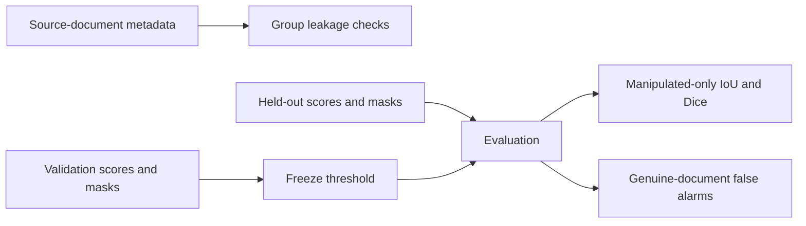

> **Proprietary — All Rights Reserved.** Copyright (c) 2026 Sandeep Grover. Public visibility does not grant a license. See LICENSE and NOTICE; written permission is required for reuse.

# Document-forensics evaluation audit

A small, runnable PyTorch evaluation component prepared as a portfolio demonstration. It checks original-document leakage, optionally stricter domain holdouts, validation-only threshold selection, manipulated-image localization, and genuine-document false alarms.

**This is not a forgery detector, trained model, or evidence of real financial-document performance.** Scores and binary masks are constructed explicitly in `main.py`. Four validation and four test images are intentionally tiny; percentages exercise software behavior, not statistical estimates of generalization.



## Run

Python 3.10+ and PyTorch 2.2 or newer (below 3). CPU operation; no downloads of model weights or datasets, no API calls, no GPU requirement.

```sh
pip install -r requirements.txt
python -m unittest -v test_forensics_eval
python main.py
```

13 tests pass. A binary segmentation model can supply N×1×H×W logits to `from_logits`; the evaluator consumes N×H×W probabilities and aligned binary masks. It deliberately rejects multiclass channels rather than guessing their meaning. No model inference implementation is claimed.

## Constructed known-answer example

The validation rule freezes a threshold of 0.8. Under that same threshold, the four constructed test images produce sensitivity 0.5, genuine-document false-positive rate 0.5, and manipulated-only mean IoU/Dice 0.5. One genuine image has one false-positive pixel out of 16. Authentic empty masks receive no localization score; they cannot inflate mean IoU by being counted as perfect segmentations.

The leakage fixture deliberately assigns an original and its named derivative to different splits and flags the source document. No JPEG encoding is performed by this example.

## Design decisions and limits

- Source-document grouping keeps derivatives together. Issuer, template, capture device and time are separate domain-generalization experiments; pass selected axes to `split_audit` when their metadata is available. Metadata correctness is an external prerequisite.
- The image score is the maximum pixel probability. It is a transparent baseline and can be resolution-sensitive; it is **not** a calibrated fraud probability.
- Threshold selection uses validation data only. When tied scores prevent a requested false-positive cap, a reject-all threshold is explicit. No claim that this tiny validation sample guarantees the population false-positive rate.
- Genuine and manipulated documents are reported separately; absent classes produce `null` instead of invented zeros. Per-image counts make the aggregated metric auditable.
- Unknown/partial masks and ignored pixels are not implemented; this version requires fully annotated binary masks and correct alignment. Real deployments need annotation-quality and region-size checks before evaluating.
- The software does not preserve original image files because it does not ingest them. An actual pipeline should preserve immutable originals, hashes and transformation history; resizing/denoising must not silently destroy forensic traces.
- No OCR, document ingestion, synthetic-forgery generation, calibration, uncertainty intervals or detector training is included. Real benchmarking needs substantially more independent documents, grouped uncertainty estimates and a reviewed test set.

## Proposed paid-assessment extension

Audit an existing model's split/provenance and failure cases; reproduce an agreed baseline if the environment and access permit; evaluate unseen templates/issuers and genuine-document false alarms at a locked operating point. Then compare targeted annotation, permitted pretraining and capture-chain-matched augmentations using the same held-out protocol. This is an assessment plan, not a promise of a particular improvement.
